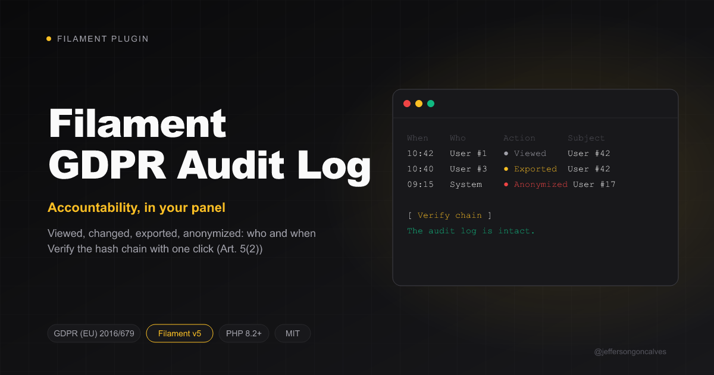

<div class="filament-hidden">



</div>

# Filament GDPR Audit Log

[](https://packagist.org/packages/jeffersongoncalves/filament-gdpr-audit-log)
[](https://github.com/jeffersongoncalves/filament-gdpr-audit-log/actions?query=workflow%3Atests+branch%3A3.x)
[](https://github.com/jeffersongoncalves/filament-gdpr-audit-log/actions?query=workflow%3A"Fix+PHP+code+styling"+branch%3A3.x)
[](https://packagist.org/packages/jeffersongoncalves/filament-gdpr-audit-log)
[](LICENSE.md)

Browse the audit trail of [laravel-gdpr-audit-log](https://github.com/jeffersongoncalves/laravel-gdpr-audit-log) from your Filament panel: who viewed, changed, exported or anonymized whose personal data, when and why. You can also check that nobody tampered with it.

## Features

- Every entry: when, who, action, data subject, columns (names only, never values) and purpose.
- Filters by action and by data subject model.
- View page with the IP address, user agent, metadata and the entry's hash.
- Who opens the list or an entry, and who verifies the chain, is logged too.
- **Verify chain:** checks the hash chain and tells you which entry was altered, removed or inserted.
- Read-only, like the log itself.
- English (more languages coming). Custom actions you record are shown as they are.

## Compatibility

| Plugin Version                                                                | Filament |
|-------------------------------------------------------------------------------|----------|
| [1.x](https://github.com/jeffersongoncalves/filament-gdpr-audit-log/tree/1.x) | 3.x      |
| [2.x](https://github.com/jeffersongoncalves/filament-gdpr-audit-log/tree/2.x) | 4.x      |
| [3.x](https://github.com/jeffersongoncalves/filament-gdpr-audit-log/tree/3.x) | 5.x      |

## Installation

You can install the package via composer:

```bash
composer require jeffersongoncalves/filament-gdpr-audit-log:"^3.0"
php artisan vendor:publish --tag="gdpr-audit-log-migrations"
php artisan migrate
```

## Usage

```php
use JeffersonGoncalves\Filament\GdprAuditLog\GdprAuditLogPlugin;

public function panel(Panel $panel): Panel
{
    return $panel
        ->plugins([
            GdprAuditLogPlugin::make()
                ->navigationGroup('GDPR')             // default: no group
                ->navigationSort(50)
                ->navigationIcon('heroicon-o-document-magnifying-glass')
                ->slug('audit-log')
                ->logViews(),                         // log who reads the log (default: on)
        ]);
}
```

All fluent methods are optional. Reading the log is logged too, with the purpose `Audit log review`: opening the list or an entry adds a `viewed` entry (its subject is the entry opened), and checking the chain adds a `verified` entry with the result. Turn it off with `->logViews(false)`.

> The resource has no authorization of its own: register it only on panels whose users may read the audit log, or add a policy for `JeffersonGoncalves\GdprAuditLog\Models\AuditLog`.

## Testing

```bash
composer test
```

## Changelog

Please see [CHANGELOG](CHANGELOG.md) for more information on what has changed recently.

## Contributing

Please see [CONTRIBUTING](.github/CONTRIBUTING.md) for details.

## Security Vulnerabilities

Please review [our security policy](../../security/policy) on how to report security vulnerabilities.

## Credits

- [Jefferson Gonçalves](https://github.com/jeffersongoncalves)
- [All Contributors](../../contributors)

## License

The MIT License (MIT). Please see [License File](LICENSE.md) for more information.
